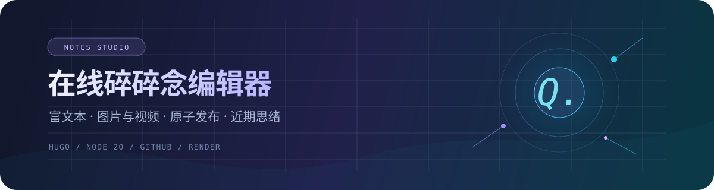

<div align="center">
  
  <h1>OweQian 的精神角落</h1>
  <p><strong>心情、日常与时光记录。</strong></p>
  <p>
    
    
    
    
  </p>
</div>

## 项目文档

| 文档 | 内容 |
| --- | --- |
| **[在线编辑器、AI 与完整部署](README.notes-online-editor.md)** | 固定账号、富文本、图片与视频、原子发布、GitHub / Render / DNS、AI 配置及验收 |
| **[心情博客改版说明](README.notes-redesign.md)** | 历史恢复、首页、时光轴、导航与视觉交互的完整修改清单 |

## 本地启动

```bash
# 主站，需要 Hugo 0.141.0 Extended
hugo server --bind 0.0.0.0 --port 1313 --appendPort=false

# 碎碎念编辑器，只监听本机，不提交或推送
node tools/notes-editor/server.mjs
```

- 主站：`http://localhost:1313/`
- 本地编辑器：`http://127.0.0.1:1314/`
- 在线编辑器：独立 Node 服务，通过 GitHub API 原子发布正文与媒体。

## 发布

推送原仓库 `dev` 或手动运行 **Deploy Hugo site to Pages**。工作流会生成近期思绪、构建 Hugo 并发布 GitHub Pages。

> [!IMPORTANT]
> 上线前按部署手册配置 `DEEPSEEK_API_KEY`。在线编辑器还需配置 Render 的 `EDITOR_PASSWORD` 与最小权限 `GITHUB_TOKEN`。真实密码和令牌只放在部署平台环境变量中，不进入仓库或公开页面。
